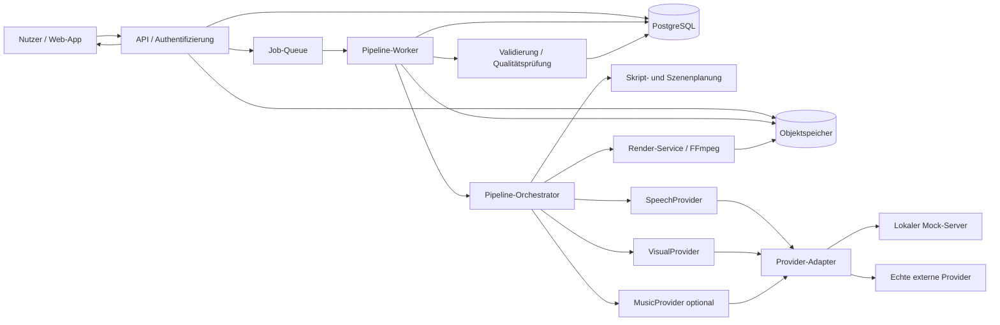

# Architekturvorschlag: Faceless-Shorts-Engine

**Status:** Architekturentwurf
**Stand:** 17. November 2026
**Ziel:** Eine robuste, erweiterbare Pipeline zur Erstellung vertikaler Kurzvideos ohne sichtbare Sprecher – von der Themenidee bis zum fertigen Video.

## Umsetzungsstand des Proof of Concept

Ein lokaler PoC für die erste technische Produktionskette ist inzwischen im Repository implementiert: HTTP-API, dateibasierte Jobpersistenz, serielle In-Process-Queue, Adapter zum bestehenden Mock-Server, FFmpeg-Rendering sowie FFprobe-Validierung und automatisierte E2E-Tests. Der Mock erzeugt weiterhin nur ein statisches Testbild und einen kurzen Testton; das Thema wird als Overlay angezeigt.

Die folgenden Zielarchitekturteile sind weiterhin Vorschläge und nicht als Produktionsfunktionen vorhanden: echte Text-/Bild-/Sprachmodelle, mehrere Worker, externe Queue, relationale Datenbank, Cloud-Objektspeicher, Benutzeroberfläche, Authentifizierung, Mandantentrennung und Social-Media-Veröffentlichung. Der PoC ist lokal zu betreiben und nicht öffentlich bereitzustellen.

## 1. Zusammenfassung

Die Engine sollte als **asynchrone Medienproduktionspipeline** aufgebaut werden. Ein Auftrag beschreibt Thema, Sprache, Zielplattform, Stil und Dauer. Die Pipeline erstellt daraus ein Skript, zerlegt es in Szenen, erzeugt oder beschafft Bild- und Sprachmedien, rendert daraus ein vertikales Video, prüft das Ergebnis und stellt es zum Download bereit.

Der vorhandene Mock-Server bleibt erhalten, wird aber **nicht direkt in die Produktionslogik eingebaut**. Stattdessen implementiert er dieselben Provider-Schnittstellen wie spätere echte Bild- und Sprachdienste. So kann die komplette Pipeline lokal und deterministisch getestet werden, während Produktivbetrieb echte Provider verwendet.

### Architekturprinzipien

- **Provider austauschbar:** Kein Pipeline-Schritt hängt an einer konkreten KI- oder Medien-API.
- **Asynchron und wiederholbar:** Längere Arbeit läuft in Jobs; Fehler können pro Schritt kontrolliert wiederholt werden.
- **Nachvollziehbar:** Eingaben, Prompts, Provider, Modellversionen und Artefakte werden je Auftrag protokolliert.
- **Idempotent:** Ein erneuter Aufruf eines abgeschlossenen Pipeline-Schritts erzeugt keine unkontrollierten Duplikate.
- **Sicher und kostenbewusst:** Medien- und KI-Aufrufe haben Grenzen, Zeitlimits, Kostenkontrollen und sichere Secret-Verwaltung.
- **Vertikal zuerst:** Ausgabe ist standardmäßig 9:16, beispielsweise 1080 × 1920 bei 30 fps.

## 2. Umfang und Annahmen

### Im ersten Produktumfang

1. Auftrag und Projektvorgaben entgegennehmen.
2. Skript mit Szenen, Sprechertext und Untertiteln erzeugen.
3. Sprecher-Audio und visuelle Szenen erzeugen oder aus einem Bestand beziehen.
4. Audio, Bildmaterial, Untertitel und optionale Musik zu einem Video montieren.
5. Ergebnis prüfen, Vorschau und Download bereitstellen.
6. Aufträge und deren Status nachvollziehbar verwalten.

### Nicht Teil der ersten Ausbaustufe

- Vollautomatisches Hochladen und Veröffentlichen auf sozialen Plattformen.
- Echtzeit- oder Livestream-Produktion.
- Komplexe kollaborative Timeline-Bearbeitung.
- Eigene Modelltrainings- oder GPU-Infrastruktur.

**Produktannahme:** Ein Nutzer startet einen Auftrag bewusst und kann vor dem Rendern Skript beziehungsweise Szenen überprüfen. Automatisches Publizieren sollte später als separater, zustimmungspflichtiger Schritt ergänzt werden.

## 3. Zielarchitektur



### Laufzeitkomponenten

| Komponente | Aufgabe | Empfehlung für den Start |
|---|---|---|
| Web-Client | Auftrag anlegen, Status verfolgen, Skript prüfen, Vorschau und Download | Responsive Web-App; zunächst einfache Formulare und Jobansicht |
| API | Authentifizierung, Validierung, Auftragsverwaltung, Status und Artefakt-URLs | Modularer HTTP-Service mit versionierten Endpunkten |
| PostgreSQL | Projekte, Aufträge, Pipeline-Schritte, Provider-Metadaten und Fehler speichern | Eine relationale Datenbank als maßgebliche Statusquelle |
| Job-Queue | Lange Aufgaben entkoppeln, wiederholen und begrenzen | Redis-basierte Queue oder verwalteter Queue-Dienst |
| Pipeline-Worker | Schritte ausführen und Zustände aktualisieren | Separater Worker-Prozess; parallele Ausführung konfigurierbar |
| Objektspeicher | Audio, Bilder, Zwischenstände, Vorschaubilder und finale Videos speichern | S3-kompatibler Speicher; lokal ein kompatibler Emulator oder Dateispeicher |
| Provider-Adapter | Einheitliche Verträge zu Mock- und Echtanbietern | Getrennte Adapter pro Fähigkeit: Text, Sprache, Bild, Musik |
| Render-Service | Szenen und Audio synchronisieren, Untertitel einbrennen, Video kodieren | FFmpeg in isoliertem Worker-Prozess/Container |
| Beobachtbarkeit | Logs, Metriken, Traces, Fehler- und Kostenübersicht | Strukturierte Logs plus Metriken für Queue und Pipeline-Schritte |

Für ein kleines MVP können API und Orchestrator zunächst in einem Repository und einem Deployment liegen. **Worker und Render-Prozess** sollten dennoch separat ausführbar bleiben, damit CPU- und Speicher-intensive Videorender nicht die API blockieren.

## 4. Rolle des vorhandenen Mock-Servers

Der aktuelle Code in `scripts/mock-media-provider.mjs` ist ein lokaler Testanbieter. Er erstellt beim Start ein einfarbiges 720 × 1280 PNG und eine einsekündige 440-Hz-WAV-Datei und bietet derzeit diese Routen:

- `GET /health`
- `GET /prompt/...` – liefert immer das gleiche PNG.
- `POST /audio/speech` – liefert immer dieselbe WAV-Datei.

Das ist für Smoke- und Integrationsprüfungen nützlich, simuliert aber noch keine echte Generierung: Der Bild-Endpunkt wertet den Prompt nicht aus, der Audio-Endpunkt ignoriert den Request-Body, und es gibt keine Job- oder Provider-Metadaten. Daher sollte der Mock **als austauschbarer Testadapter** behandelt und sein Vertrag dokumentiert werden; die Produktionspipeline darf nicht von der zufälligen Form der Mock-URLs abhängen.

### Vorgeschlagene Provider-Verträge

Die Pipeline ruft fachliche Schnittstellen auf, zum Beispiel:

```text
TextProvider.generateScript(request) -> ScriptDraft
SpeechProvider.synthesize(request) -> AudioAsset
VisualProvider.generateScene(request) -> ImageAsset | VideoAsset
MusicProvider.generateTrack(request) -> AudioAsset
```

Jede Antwort sollte mindestens Folgendes enthalten:

```text
asset_id, provider, model, mime_type, duration_ms?, width?, height?, storage_uri,
request_id?, created_at, metadata
```

Der Mock-Adapter implementiert dieselben Schnittstellen, legt seine Dateien im temporären oder konfigurierten Testspeicher ab und liefert deterministische Ergebnisse. Falls die bestehenden HTTP-Routen beibehalten werden, kapselt ausschließlich der Mock-Adapter deren Details. Ein späterer API-Umbau erfolgt dann ohne Änderung an Orchestrator oder Render-Service.

**Wichtig:** Echte Provider-Adapter müssen Timeouts, begrenzte Wiederholungen, Rate-Limits, Provider-Fehlerübersetzung und sichere Behandlung von Zugangsdaten implementieren. Es darf nicht automatisch dieselbe Generierungsanfrage beliebig oft erneut abgesetzt werden, da manche Provider-Aufrufe kostenpflichtig sind.

## 5. Produktionsablauf

1. **Auftrag anlegen:** Nutzer gibt Thema, Sprache, Zielplattform, gewünschte Dauer, Tonalität, Zielgruppe und optionale Markenregeln an.
2. **Validieren:** Eingaben, Dauer, erlaubte Dateitypen und Kontingente prüfen; Auftrag mit Status `queued` speichern.
3. **Briefing und Skript:** Text-Provider erstellt Hook, Sprechertext, Szenenentwurf und Call-to-Action. Ergebnisse werden als versionierter Entwurf gespeichert.
4. **Skriptprüfung:** Nutzer kann den Entwurf freigeben oder bearbeiten. Bei explizitem Autopilot-Modus kann dieser Schritt übersprungen werden.
5. **Szenenplanung:** Sprechertext wird in Szenen aufgeteilt. Jede Szene erhält Zeitbudget, Visual-Prompt, Untertiteltext und gegebenenfalls Such-/Asset-Anweisung.
6. **Medienerstellung:** Sprach-Audio und visuelle Assets werden pro Szene über Provider-Adapter erzeugt. Optional wird lizenzgeeignete Musik gewählt oder generiert.
7. **Vorverarbeitung:** Dauer, Lautheit, Bildformat, Dateiintegrität und Nutzungsmetadaten prüfen. Assets auf einheitliche technische Eigenschaften bringen.
8. **Rendern:** Szenenreihenfolge, Voiceover, Musik, Untertitel und Übergänge zu einem Video zusammensetzen.
9. **Qualitätsprüfung:** Auflösung, Bildrate, Codec, Laufzeit, Audiopegel, schwarze/leere Frames und fehlende Dateien prüfen.
10. **Abschluss:** Finale Datei und Vorschaubild im Objektspeicher ablegen, Status `completed` setzen und Download bereitstellen.

### Zustandsmodell

```text
queued -> planning -> awaiting_review -> generating_assets -> rendering -> validating -> completed
   |          |              |                  |               |            |
   +----------+--------------+------------------+---------------+----------> failed
```

Ein Auftrag kann außerdem `cancelled` sein. Jeder Schritt sollte einen eigenen Status, Start-/Endzeit, Versuchsnummer und maschinenlesbaren Fehlercode besitzen. Ein Fehler an einem Asset sollte – wo fachlich sinnvoll – nur dieses Asset erneut erzeugen und nicht alle vorherigen Schritte wiederholen.

## 6. Datenmodell (Vorschlag)

### `projects`

- `id`, `owner_id`, `name`
- `defaults_json`: Sprache, Stil, Branding, Standardformat
- `created_at`, `updated_at`

### `shorts_jobs`

- `id`, `project_id`, `owner_id`
- `status`, `progress_percent`, `current_step`
- `input_json`: Thema und Nutzervorgaben
- `script_version_id`, `output_asset_id`
- `idempotency_key`, `created_at`, `updated_at`, `completed_at`

### `pipeline_steps`

- `id`, `job_id`, `step_type`, `status`, `attempt`
- `input_json`, `output_json`, `provider`, `model`
- `error_code`, `error_message_safe`, `started_at`, `finished_at`

### `scenes`

- `id`, `job_id`, `position`, `narration_text`, `caption_text`
- `visual_prompt`, `planned_duration_ms`, `asset_id`

### `assets`

- `id`, `job_id`, `scene_id?`, `asset_type`, `storage_uri`
- `mime_type`, `size_bytes`, `duration_ms?`, `width?`, `height?`
- `checksum`, `provider`, `model`, `license_metadata_json`, `created_at`

Große Binärdateien gehören **nicht** in PostgreSQL, sondern in den Objektspeicher. In der Datenbank bleiben URI, Metadaten, Prüfsumme und Beziehungen. Provider-Antworten sollten vor dem Speichern auf personenbezogene oder geheime Daten geprüft beziehungsweise minimiert werden.

## 7. API-Skizze

Beispielhafte versionierte API:

```text
POST   /api/v1/projects
GET    /api/v1/projects/{project_id}
POST   /api/v1/shorts-jobs
GET    /api/v1/shorts-jobs/{job_id}
POST   /api/v1/shorts-jobs/{job_id}/approve-script
POST   /api/v1/shorts-jobs/{job_id}/retry-step
POST   /api/v1/shorts-jobs/{job_id}/cancel
GET    /api/v1/shorts-jobs/{job_id}/assets
GET    /api/v1/shorts-jobs/{job_id}/download
GET    /api/v1/health
```

`POST /shorts-jobs` sollte eine `Idempotency-Key`-Angabe akzeptieren. Das Anlegen gibt schnell `202 Accepted` mit `job_id` und Status zurück; der Client fragt den Status ab oder erhält später per Server-Sent Events eine Statusänderung. Download-URLs sollten zeitlich begrenzt und nur für berechtigte Nutzer verfügbar sein.

## 8. Rendering- und Medienregeln

### Standardprofil für Kurzvideos

- Seitenverhältnis: **9:16**.
- Standardauflösung: **1080 × 1920**, mit optionalem niedrigerem Profil für Vorschau.
- Container/Codec: **MP4 mit H.264-Video und AAC-Audio** für breite Kompatibilität.
- Bildrate: **30 fps** als Standard; Profil soll konfigurierbar sein.
- Untertitel: aus Szenen-/Skript-Timing erzeugen; lesbarer Kontrast, sichere Ränder und keine Überdeckung wichtiger Bildelemente.
- Audio: Voiceover verständlich priorisieren; Musik leiser mischen und Spitzen begrenzen.
- Szenen: Mindest-/Maximaldauer und Gesamtlaufzeit vor dem Rendern validieren.

### Render-Schritte

1. Quelldateien in Arbeitsverzeichnis herunterladen oder einbinden.
2. Medien mit FFprobe analysieren; ungültige oder unerwartete Formate ablehnen.
3. Bilder/Clips auf ein gemeinsames Canvas skalieren und croppen.
4. Szenen nach Plan timen; bei statischen Bildern mit Bewegung/Zoom arbeiten, sofern gewünscht.
5. Voiceover ausrichten; Stille und Segmentgrenzen kontrollieren.
6. Untertitel ausgeben und optional einbrennen.
7. Musikspur mischen und Lautheit begrenzen.
8. MP4 in temporäre Datei rendern, anschließend validieren und atomar veröffentlichen.

Temporäre Renderdateien sind zu löschen, wenn der Job abgeschlossen oder endgültig fehlgeschlagen ist. Der finale Export muss erst nach erfolgreicher Validierung als Download erscheinen.

## 9. Fehlerbehandlung, Wiederholungen und Kostenkontrolle

- Wiederholungen nur bei transienten Fehlern (Netzwerkfehler, `429`, ausgewählte `5xx`), mit exponentiellem Backoff und Zufallsanteil.
- Keine endlosen Retries: pro Schritt konfigurierbare Maximalversuche und Gesamtlaufzeit.
- Fachliche Fehler wie ungültige Eingaben oder verweigerte Inhalte nicht automatisch wiederholen.
- Vor jedem kostenpflichtigen Provider-Aufruf Nutzungs-/Kostenbudget prüfen.
- Bei Wiederholung einen stabilen Idempotency-Key verwenden, sofern der Provider das unterstützt.
- Kosten je Auftrag und Schritt mit Provider, Modell und Nutzungsmetrik erfassen.
- Nach einem irreversiblen Fehler den Auftrag auf `failed` setzen, sichere Fehlermeldung anzeigen und interne Stacktraces nur in geschützte Logs schreiben.
- Render-Schritte nach erfolgreichem Abschluss persistieren; erneutes Rendern soll nur bei geänderten Eingaben oder bewusstem Retry stattfinden.

## 10. Sicherheit, Rechte und Datenschutz

- Authentifizierung und autorisierungsgeprüfte Projekt-/Auftragszugriffe.
- API-Schlüssel ausschließlich in Secret-Management oder Umgebungsvariablen des Laufzeitdienstes; niemals in Repository, Frontend, Logs oder Job-Payloads.
- Eingaben und hochgeladene Assets validieren; Dateigrößen und Laufzeiten begrenzen.
- Downloads über kurzlebige signierte URLs; Speicherung nicht öffentlich schalten.
- Render-Prozesse isolieren und Shell-Aufrufe nicht mit ungeprüften Nutzereingaben zusammensetzen.
- FFmpeg-Dateien und Medienparser als nicht vertrauenswürdige Eingaben behandeln; Container-/CPU-/Speicherlimits anwenden.
- Rechte und Lizenzbedingungen für Bilder, Musik, Stimmen und Schriftarten dokumentieren. Asset-Metadaten sollen Herkunft und Nutzungsbedingungen nachvollziehbar machen.
- Löschfristen und Nutzerlöschung für Quell- und Zwischenmedien vorsehen.
- Datenschutzfreundliche Logs: keine unnötige Speicherung vollständiger Skripte, Schlüssel oder sensibler Nutzerdaten.
- Für Stimmen und Markeninhalte klare Berechtigungen und Inhaltsregeln definieren.

## 11. Teststrategie

### Unit-Tests

- Skript-/Szenen-Validierung, Dauerberechnung und Statusübergänge.
- Provider-Fehlerübersetzung, Retry-Regeln und Kostenbudget.
- Render-Konfiguration und Dateinamen-/Pfadbehandlung.

### Integrationstests mit dem Mock-Server

- Health-Check und Verfügbarkeit der Testmedien.
- Mock-Adapter übersetzt Provider-Anfragen in die vorhandenen Test-Routen.
- Pipeline kann mit deterministischem Bild und Ton einen vollständigen Test-Job ausführen.
- Fehlerfälle: Server nicht erreichbar, unbekannter Pfad, ungültige Medienantwort, Render-Fehler.
- Keine echten API-Schlüssel oder externen kostenpflichtigen Aufrufe im Standard-CI-Lauf.

### End-to-End-Tests

- Auftrag anlegen → Skript freigeben → Mock-Medien beziehen → rendern → Export validieren.
- Exportdaten mit FFprobe prüfen: Container, Codec, Auflösung, Laufzeit und Audio vorhanden.
- Wiederholte Ausführung mit gleichem Idempotency-Key erzeugt keinen doppelten Auftrag.

### Qualitätsprüfungen

- Visuelle Stichproben oder automatisierte Prüfungen auf leere Frames, falsches Seitenverhältnis und unlesbare Untertitel.
- Audio-Prüfung auf Stille, Clipping und fehlendes Voiceover.
- Produktions-Provider getrennt und mit expliziten Testbudgets testen.

Der vorhandene Mock unterstützt aktuell deterministische Medien- und Health-Tests, aber noch keine Fehlersteuerung, variable Inhalte oder verzögerte Antworten. Diese Fähigkeiten können später ergänzt werden, ohne sie zur Voraussetzung für den ersten Integrationslauf zu machen.

## 12. Deployment und Betrieb

### Lokale Entwicklung

- API, Worker, Datenbank, Queue und Objektspeicher-Emulator über eine lokale Entwicklungsumgebung starten.
- `scripts/mock-media-provider.mjs` auf Port 4010 als Medienprovider-Testdouble starten.
- Konfiguration über `.env.example`; echte Geheimnisse bleiben außerhalb des Repositorys.
- Ein einzelner Worker und niedrige Queue-Konkurrenz als Standard.

### Produktionsbetrieb

- API und Worker getrennt deployen; Renderer mit begrenzten CPU-/RAM-Ressourcen isolieren.
- Datenbank, Queue und Objektspeicher möglichst als verwaltete Dienste betreiben.
- Autoscaling primär nach Queue-Tiefe und Render-Auslastung.
- Queue-DLQ (Dead Letter Queue) für endgültig fehlgeschlagene Jobs.
- Health- und Readiness-Probes; der API-Health-Endpunkt sollte Datenbank/Queue-Erreichbarkeit differenziert melden.
- Backups für Metadaten und klare Aufbewahrungs-/Löschregeln für Medien.
- Warnungen bei wachsender Queue, hoher Fehlerrate, Speichermangel, Renderzeitüberschreitung und ungewöhnlichen Provider-Kosten.

## 13. Vorgeschlagene Repository-Struktur bei Umsetzung

```text
src/
  api/                 # HTTP-Routen, Auth, DTOs
  application/         # Use Cases und Auftragsorchestrierung
  domain/              # Job-, Szenen- und Asset-Modelle, Regeln
  providers/
    contracts/         # TextProvider, SpeechProvider, VisualProvider
    mock/              # Adapter zum vorhandenen lokalen Mock-Server
    real/               # Provideradapter, einzeln konfigurierbar
  pipeline/             # Planen, Medienerstellung, Validierung
  render/               # FFmpeg-Komposition und Untertitel
  storage/              # Objektspeicherabstraktion
  queue/                # Queue-Integration und Worker
  observability/        # Logs, Metriken, Tracing
scripts/
  mock-media-provider.mjs
  ...
tests/
  unit/
  integration/
  e2e/
Dockerfile.api
Dockerfile.worker
compose.yaml
.env.example
README.md
ARCHITECTURE.md
```

Dies ist eine Zielstruktur, keine Beschreibung des heutigen Repository-Inhalts. Die Implementierung kann mit einem einzigen Laufzeitstack beginnen; die fachlichen Grenzen sollten trotzdem bereits durch Module und Provider-Verträge sichtbar sein.

## 14. Umsetzung in Etappen

### Etappe 1 – Lauffähiger vertikaler MVP

- API zum Anlegen und Abfragen eines Jobs.
- SQLite oder PostgreSQL, zunächst einfache Queue bzw. ein Worker.
- Mock-Provider-Adapter für das vorhandene PNG und WAV.
- FFmpeg-Render eines vertikalen Testvideos mit einfachem Untertitel.
- E2E-Test vom Auftrag bis zum validierten MP4.

**Abnahmekriterium:** Ein Testauftrag kann ohne externe Medien-API reproduzierbar ein Video erzeugen und dessen Status sowie Download liefern.

### Etappe 2 – Inhaltserstellung

- Text-Provider und strukturierte Skript-/Szenenausgabe.
- Review-/Freigabeschritt.
- Speech-Provider mit Audio-Timing und optionaler Untertitel-Synchronisierung.
- Speicherung versionierter Skripte und Medienmetadaten.

### Etappe 3 – Visuelle Medien und Qualität

- Bild-/Video-Provider über Adapter.
- Szenenbezogene Asset-Erstellung und Wiederaufnahme fehlgeschlagener Einzelschritte.
- Automatische Qualitätsprüfungen und Vorschau.

### Etappe 4 – Stabilisierung und Skalierung

- Nutzerkonten, Projekte, Kontingente und Kostenübersicht.
- Separate skalierbare Worker und Render-Container.
- Monitoring, Alarmierung, Datenaufbewahrung und belastbare Backup-/Restore-Prozesse.

### Etappe 5 – Erweiterungen

- Mehrere Vorlagen und Branding-Presets.
- Musikbibliothek mit Rechte-Metadaten.
- Plattformprofile, Untertitelsprachen und optionale Veröffentlichung mit expliziter Nutzerfreigabe.

## 15. Entscheidungen, die vor der Implementierung zu klären sind

1. Ist die Engine zunächst Einzelplatz-/lokal oder ein Mehrnutzer-Webdienst?
2. Welche Zielplattformen, Videolängen und Qualitätsprofile sind verbindlich?
3. Welche Text-, Sprach-, Bild- und Videoanbieter dürfen eingesetzt werden, und welches Budget gilt pro Auftrag?
4. Soll ein Mensch jedes Skript vor der Mediengenerierung freigeben?
5. Wie lange sollen Originale, Zwischenmedien und fertige Videos gespeichert werden?
6. Welche Rechteanforderungen gelten für Stimmen, Musik, Stockmaterial und generierte Assets?
7. Welcher Objektspeicher und welche Laufzeitumgebung sind für den Betrieb vorgesehen?

## Empfehlung

Als erster Implementierungsschritt sollte ein **durchgängiger, deterministischer Mock-Workflow** entstehen: API-Auftrag → feste Skript-/Szenendaten → Mock-Bild und Mock-Audio → FFmpeg-Render → FFprobe-Validierung → Download. Danach werden einzelne Adapter nacheinander durch echte Provider ersetzt. So wird zuerst die technische Produktionskette bewiesen, ohne früh Anbieterabhängigkeiten oder variable KI-Ausgaben zum Testhindernis zu machen.
